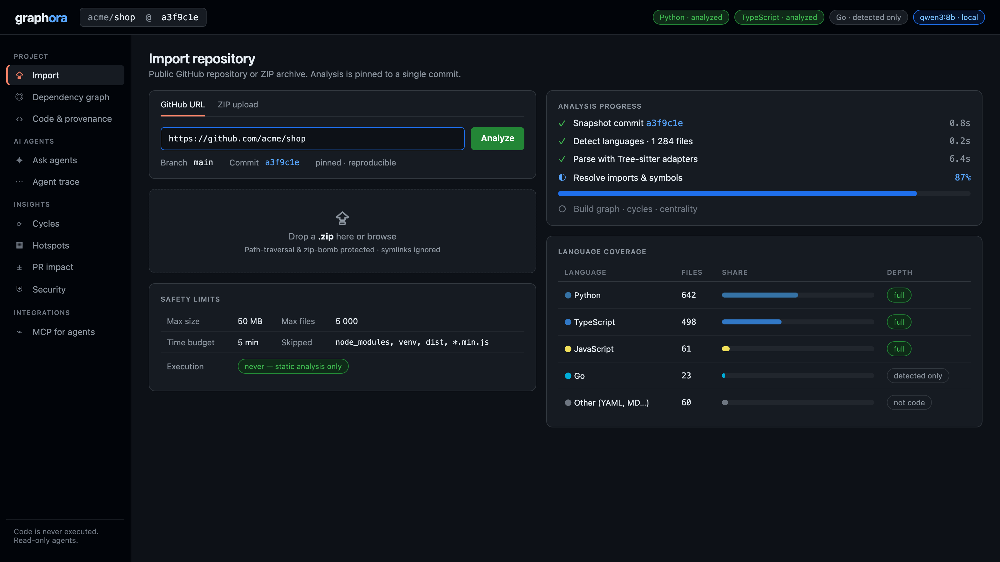
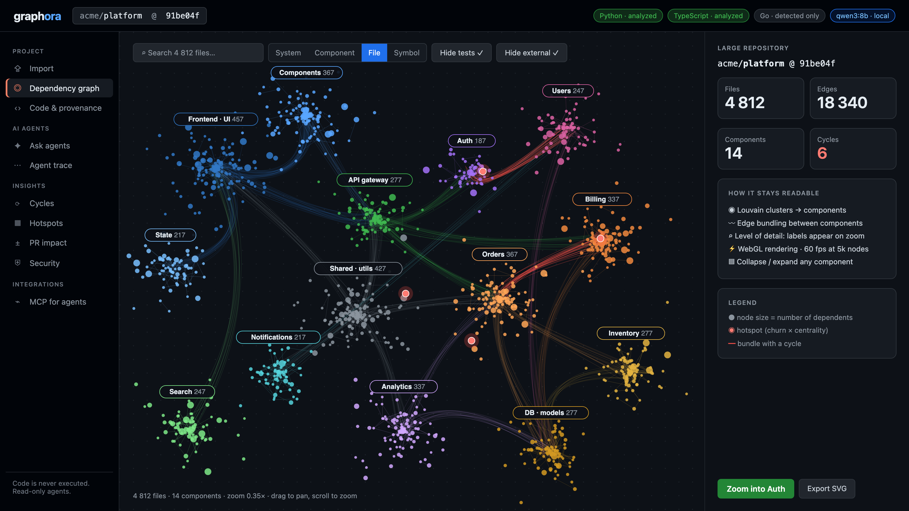
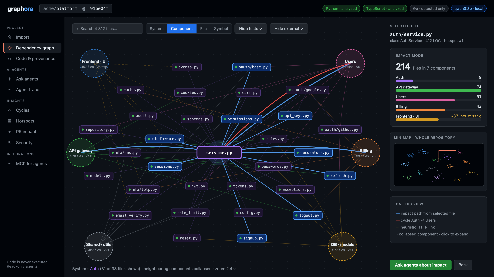
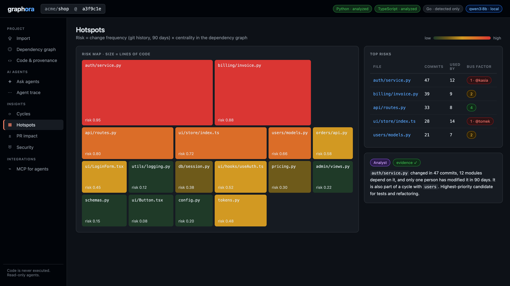

## Vision

AI agents now write code faster than humans can understand it.
The bottleneck is no longer writing code — it's knowing what it actually does.

**Graphora** builds a static, commit-pinned dependency graph with provenance on every edge (`file:line@commit`, confidence level).
Cycles, reverse dependencies and change impact are computed algorithmically, not inferred by a model.
Collaborating AI agents answer questions on top of it, and a deterministic verifier
downgrades any claim not backed by the graph to a hypothesis.

We don't compete with coding agents — we give them a map.
Via MCP, Claude Code, Cursor and others get transitive dependency answers in one tool call instead of grepping through the repo.

> AI agents generate answers. Graphora gives them — and you — facts.
  
 

<b>Demo</b>

 

Import a public GitHub repository or ZIP, pinned to one commit. Code is never executed.

The whole repository as one map: files grouped into components, edges bundled, hotspots highlighted.

Zoom into a component to see what a change to one file would affect.

Risky files: frequently changed and heavily depended on.

More screens in [docs/demo](docs/demo).

## Authors

This project was completed as part of the AI Agents class at Warsaw University of Technology.

© Anna Granos, Ulyana Frolova, 2026
