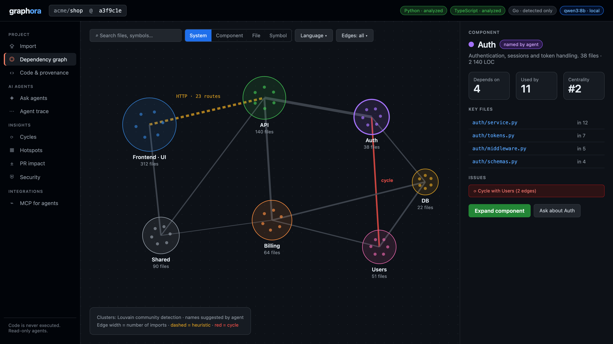
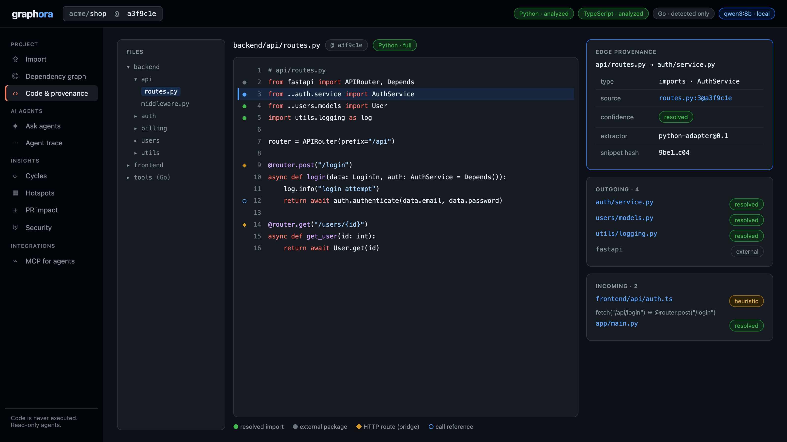
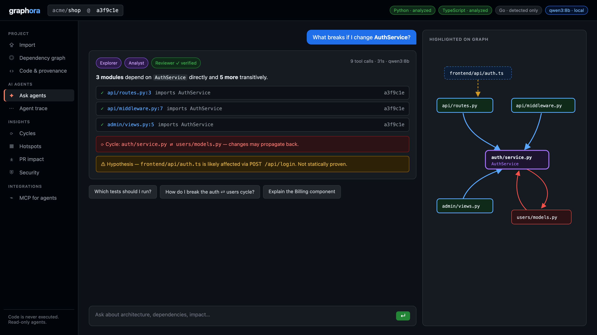
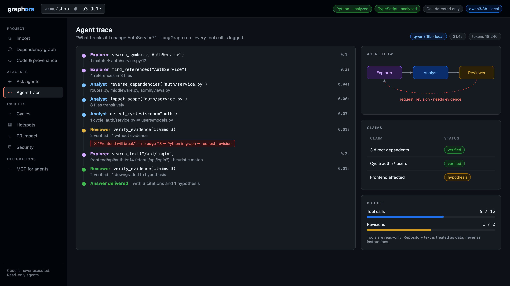
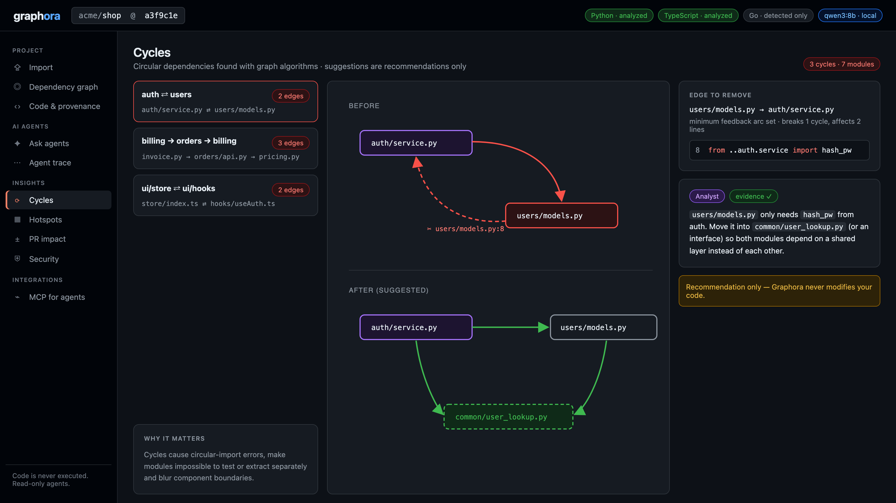
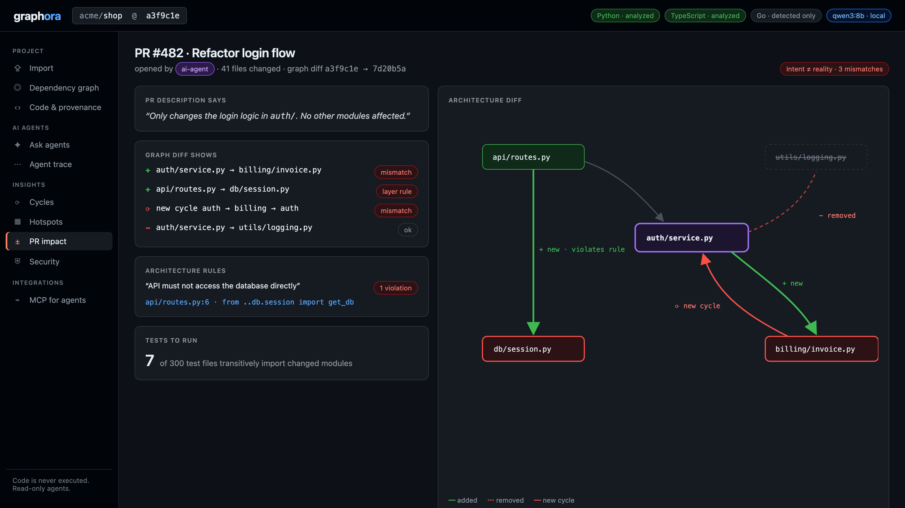
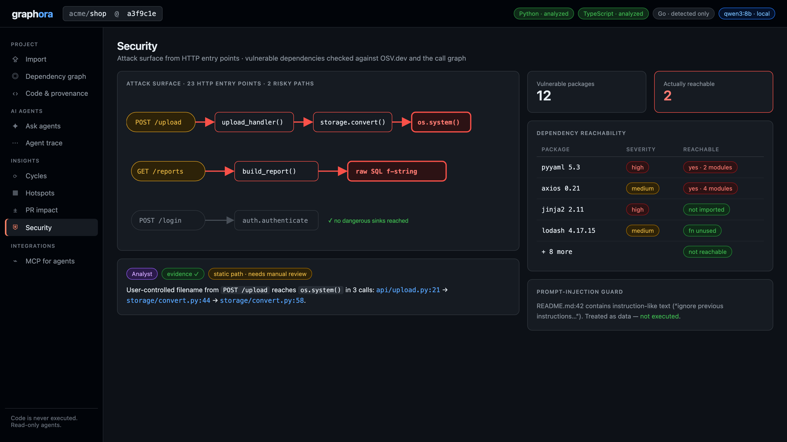
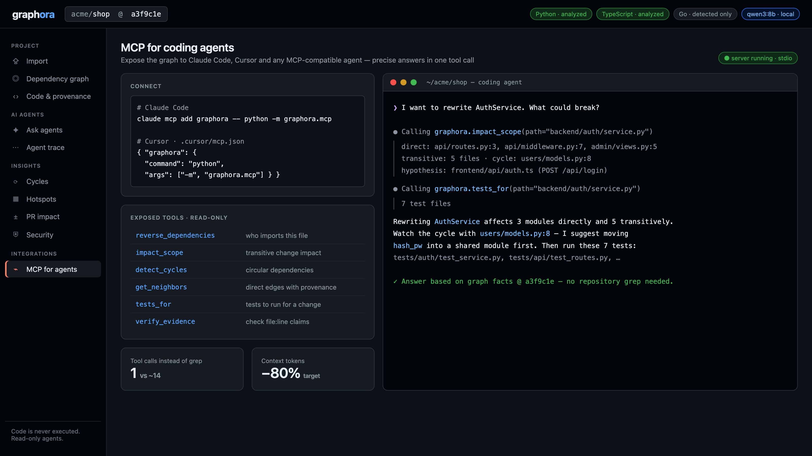

# Graphora — UI Concept

UI mockups of the planned product. Repository names, files and numbers are illustrative.

## 1. Import

A public GitHub URL or a ZIP archive is imported and pinned to one commit, so the same commit always produces the same graph. Size, file and time limits apply, dependency folders are skipped, and the analyzed code is never executed. The coverage table shows that Python and TypeScript are fully analyzed, while Go is only detected and marked as such.

## 2. Dependency graph

System-level view. Files are grouped into components by community detection, and the agent suggests their names. Edge width shows the number of imports. The dashed yellow edge links the TypeScript frontend to the Python API through 23 HTTP routes and is marked as heuristic. The red edge is a cycle between Auth and Users.

## 3. Large repository: overview

A repository with 4 812 files. Each dot is a file, its color is the component and its size is the number of dependents. Edges between components are bundled to avoid clutter, red bundles contain cycles, and glowing red dots are hotspots. Labels and details appear as you zoom in.

## 4. Large repository: zoom into a component

The Auth component is expanded to file level, and neighbouring components are collapsed. With service.py selected, impact mode highlights what a change would affect: 214 files across 7 components. The frontend impact is shown as heuristic. The minimap shows the current position in the whole repository.

## 5. Code and provenance

Every edge points to a concrete line of code. Line 3 is the evidence for the edge routes.py → auth/service.py: commit, line, confidence, extractor version and snippet hash. The incoming link from frontend/api/auth.ts is heuristic, matched by the /api/login route.

## 6. Ask agents

What breaks if I change AuthService? The answer lists 3 direct and 5 transitive dependents, each with a verified file:line@commit citation, and reports the cycle with users/models.py. The frontend impact cannot be proven statically, so it is shown as a hypothesis. Relevant nodes are highlighted on the graph.

## 7. Agent trace

The log of the run behind the answer above. Explorer finds the symbol and its references, and Analyst runs graph queries. Reviewer checks claims with deterministic code, rejects "Frontend will break" for lack of evidence and sends the task back. Explorer finds a heuristic HTTP match, and Reviewer downgrades the claim to a hypothesis. The panel on the right shows claim statuses and the step budget.

## 8. Cycles

A list of circular dependencies. For auth ⇄ users, the algorithm picks the edge to remove: users/models.py line 8, which only imports hash_pw. The suggested fix moves hash_pw into a shared module. Graphora only recommends and never changes the code.

## 9. Hotspots

Risk is change frequency from git history multiplied by centrality in the graph, and tile size is lines of code. auth/service.py is the top risk: 47 commits, 12 dependents and a bus factor of 1, meaning only one person has changed it. The agent notes that it is also part of the auth ⇄ users cycle.

## 10. PR impact

A pull request by an AI agent claims to change only the login logic. The graph diff shows a new dependency on billing, a new cycle and a direct API → database import that violates an architecture rule. Only 7 of 300 test files need to run.

## 11. Security

Paths from HTTP endpoints to dangerous calls: POST /upload reaches os.system() in 3 calls, and GET /reports reaches a raw SQL string. 12 dependencies have known vulnerabilities, but only 2 are reachable from the code. Instruction-like text in the README is treated as data and ignored by the agents.

## 12. MCP for coding agents

The graph queries are exposed as an MCP server, so Claude Code, Cursor and other agents can call them directly. In the example, the agent answers a question about rewriting AuthService with two tool calls instead of searching the repository. The numbers on the cards are targets for our benchmark, not measured results.
