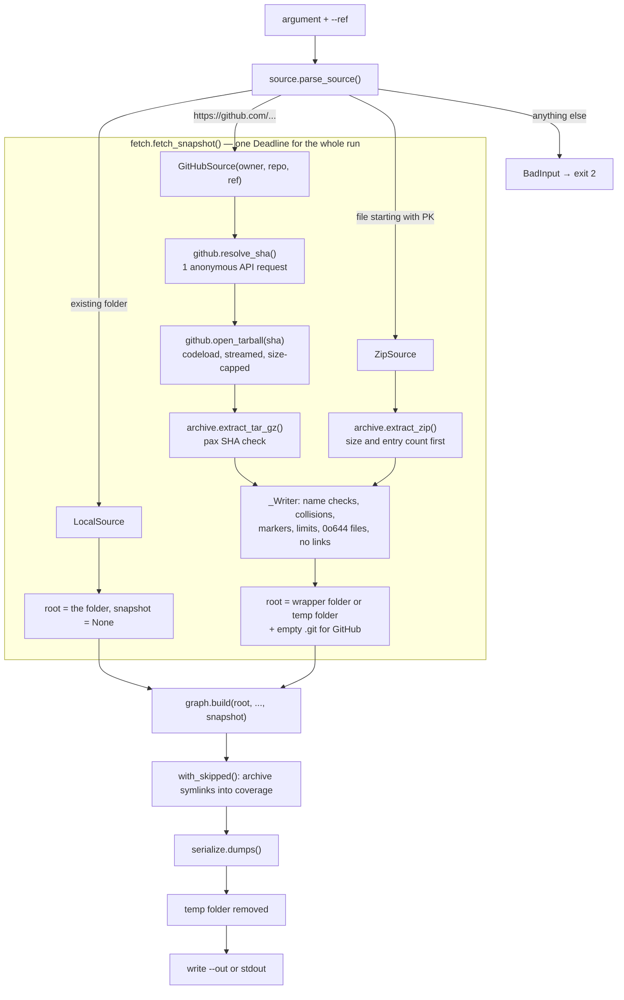

# Implementation Plan: Repository Ingest from GitHub and ZIP

**Branch**: `002-repo-ingest` | **Date**: 2026-10-28 | **Spec**: [spec.md](spec.md)

**Input**: Feature specification from `specs/002-repo-ingest/spec.md`

## Summary

This slice lets `graphora analyze` take a public GitHub link or a ZIP file in place of a local folder, and
produce the same graph as for a folder.

What changes for the user:

- `graphora analyze https://github.com/<owner>/<repo>[/tree/<ref>]` or `... --ref <ref>`: one anonymous API
  request resolves the ref to a commit SHA (R2); the tarball of that SHA is streamed from `codeload` (R3).
  The snapshot id is the SHA, so provenance becomes `file:line@<sha>` for remote repositories.
- `graphora analyze project.zip`: the archive is extracted and analyzed; the snapshot id is
  `content:<hash>`, as for a folder without git.
- New limits (`--max-archive-bytes`, `--max-extract-bytes`, `--max-entries`), one deadline for the whole
  run, and new exit statuses `4` (unsafe or invalid archive), `5` (remote failure) and `130` (interrupted).

How it works:

- **Safe extraction** (R5, R6). Our own extractor for tar and ZIP. It never calls `extractall`, never
  creates links, writes only `0o644` files with `O_EXCL | O_NOFOLLOW`, rejects traversal, hardlinks,
  devices and case/Unicode collisions, and checks limits before each write.
- **Same walk as a clone** (R9). Content the walk skips by name (`node_modules`, `.git`, minified files) is
  written as empty markers, so the unchanged walk reports identical skipped paths. Archive symlinks are
  merged into `skipped` after `build()`.
- **Graph building.** `build()` gains one optional `snapshot` parameter (FR-014); nothing else in
  `graph/` changes. The schema does not change.
- **Cleanup.** `fetch_snapshot()` is a context manager over one `graphora-*` temp folder, removed on any
  exit including `SIGINT`/`SIGTERM` (R11).

## Technical Context

**Language/Version**: Python ≥ 3.12, developed on 3.12 and 3.14 (unchanged)

**Primary Dependencies**: no new dependencies. Standard library `urllib.request`, `tarfile`, `zipfile`,
`gzip`, `tempfile`, `unicodedata`, `signal` (R1). Existing `tree-sitter*` and `dulwich==1.2.19` unchanged

**Storage**: None. One temp folder per run, removed at the end; the output is one JSON file

**Testing**: pytest. Unit (source parsing, GitHub client with a fake opener, extractor with in-memory
hostile archives), integration (CLI exit statuses, cleanup and interruption, no-network guard), golden
equivalence (every fixture through a fake GitHub tarball equals its clean local clone byte for byte; every
fixture as ZIP equals its folder graph except the snapshot id). No new fixture repositories

**Target Platform**: macOS and Linux developer machines and CI. No `git` binary, no network in tests

**Project Type**: CLI, inside the `backend` package

**Performance Goals**: a repository at the default walk limits (5,000 files, 50 MB) fetched and analyzed
within 300 s on a home connection (SC-007). Streaming: no archive copy on disk, gzip and tar read in one
pass, 64 KiB chunks

**Constraints**:

- byte-identical output for local folders (FR-015) and for a GitHub SHA versus its clean clone (FR-016,
  with the R12 caveat);
- nothing from an archive is executed, linked, made executable or written outside the temp folder;
- at most the extracted-size limit is ever written (SC-005);
- no credentials, one API request per run;
- the suite runs offline.

**Scale/Scope**: archives up to 200 MiB compressed and 200 MiB written, 20,000 entries by default (R8)

No open questions remain. Planning found three spec points to correct; they are applied in spec.md:

- **Non-ZIP file** (R4). A file without a ZIP signature is bad input (status `2`), not an invalid archive.
  The existing test `test_path_is_file` requires this.
- **Name collisions** (R5). Paths that differ only by case or Unicode normalisation are rejected on every
  system, not only on case-insensitive disks, for deterministic results.
- **Export attributes** (R12). GitHub archives honour `export-ignore`/`export-subst`, so FR-016 holds for
  repositories that do not use them.

## Constitution Check

*GATE: checked before Phase 0, and re-checked after Phase 1.*

| Principle | How this plan complies | Status |
|---|---|---|
| I. Never execute analyzed code | Archives are parsed by `tarfile`/`zipfile` as data and written by our own code: no `extractall`, no links, mode `0o644`, `O_NOFOLLOW`, path checks plus a real-path check (R5). Limits on archive size, written bytes, entries and time are enforced before writing (R7, R8). No `.git` data from an archive is written, so dulwich never parses archive content (R9). No subprocess. The safety tests gain hostile tar and ZIP cases and a marker-file check | ✅ |
| II. Deterministic output | Extraction order does not matter: the walk sorts, recorded symlinks are sorted, collisions are rejected by a system-independent rule (NFC + casefold). Temp paths never reach the output. A test runs each ingest twice and compares bytes | ✅ |
| III. Provenance on every edge | GitHub snapshots carry the full commit SHA resolved before download and cross-checked against the archive's pax comment (R3). ZIP uses `content:<hash>` as the constitution prescribes for non-git folders | ✅ |
| IV. Honest confidence | No resolver change. Fetched content goes through the same adapters and resolvers with no special cases | ✅ (n/a) |
| V. Facts by code | No LLM in this slice | ✅ (n/a) |
| VI. Analyzed content is data | No model reads content. Archive names appear in error messages only as data | ✅ (n/a) |
| VII. One graph query layer | No query logic added. Schema unchanged: hardlinks are rejected rather than given a new skip reason (clarification 4). `build()` gains one optional parameter, reviewed by its owner | ✅ |
| VIII. Golden tests | Existing golden tests unchanged. New equivalence tests run every fixture through the GitHub and ZIP paths and compare with the hand-checked local results (R10) | ✅ |
| Tech constraints | Python and `uv`; no new dependency | ✅ |
| Workflow | One branch and one PR; the change to `graph/build.py` is reviewed and approved by Ulyana as module owner | ✅ |

**Re-check after Phase 1:** the design adds no violations. The data model keeps every new type inside
`graphora/ingest/`; the CLI contract only adds options and statuses; the local path is unchanged. One
dependency on R9 is worth stating: byte-identity with a clone relies on the walk's skip rules being the
only name-based rules. If a later feature adds rules to the walk, `archive.py` must reuse
`is_excluded_path` and `EXCLUDED_DIRS` (it imports them, not a copy), so this stays automatic.

## Project Structure

### Documentation (this feature)

```text
specs/002-repo-ingest/
├── spec.md
├── plan.md                 # this file
├── research.md             # R1–R14
├── data-model.md           # Source, IngestLimits, FetchedSnapshot, entry classification, errors
├── quickstart.md           # validation guide
├── contracts/
│   ├── cli.md              # changes to the analyze command
│   └── ingest-api.md       # fetch_snapshot(), build(snapshot=) for 005 and 007
├── checklists/requirements.md
└── tasks.md                # /speckit-tasks
```

### Source Code (repository root)

```text
backend/
├── src/graphora/
│   ├── ingest/
│   │   ├── errors.py           # BadInput, UnsafeArchive, InvalidArchive, RemoteError
│   │   ├── source.py           # parse_source(): folder / GitHub link / ZIP, link and ref rules
│   │   ├── github.py           # opener with redirect allow-list, resolve SHA, stream tarball
│   │   ├── archive.py          # safe tar/ZIP extraction, markers, limits, top-folder choice
│   │   ├── fetch.py            # IngestLimits, FetchedSnapshot, fetch_snapshot(), with_skipped()
│   │   ├── walk.py             # + Deadline.remaining(); otherwise unchanged
│   │   └── snapshot.py         # unchanged
│   ├── graph/build.py          # + optional snapshot parameter (owner review)
│   └── cli/__init__.py         # <source>, --ref, new limits, statuses 4/5/130, signal handling
└── tests/
    ├── conftest.py             # + autouse no-network guard
    ├── archives.py             # in-memory tar.gz / ZIP builders, hostile entries, bombs
    ├── fake_github.py          # fake opener: canned statuses, chunked and stalled bodies
    ├── unit/
    │   ├── test_no_network.py  # the guard itself
    │   ├── test_deadline.py    # Deadline.remaining()
    │   ├── test_build_snapshot.py  # build(snapshot=) on every fixture
    │   ├── test_source.py      # argument detection, link forms, --ref rules, ref names, ZIP signature
    │   ├── test_github.py      # status mapping, rate limit, redirects, SHA checks, size and time limits
    │   └── test_archive.py     # every row of the entry classification table, tar and ZIP
    ├── integration/
    │   ├── test_ingest_cli.py      # exit statuses and messages end to end, --out untouched on failure
    │   ├── test_ingest_cleanup.py  # no graphora-* left after success, each failure, interrupt
    │   └── test_safety_ingest.py   # setup.py, conftest.py, npm scripts, git hooks are never run
    └── golden/
        └── test_ingest_equivalence.py  # every fixture: GitHub tarball == clean clone; ZIP == folder
```

Existing tests are not edited (FR-015).

**Structure Decision**:

- All new code sits in `graphora/ingest/`, which already owns reading the analyzed tree. The fetch step is
  a library API so that 005 and 007 call it directly ([contracts/ingest-api.md](contracts/ingest-api.md)).
- `graph/` changes by one parameter. No `api/`, `store/` or new top-level folder; those belong to 005 and
  007.

## Architecture

One run of `graphora analyze <source>`. Everything inside the `with fetch_snapshot(...)` block runs while
the temp folder exists; `--out` is written only after it is removed.



| Source | Snapshot id | Temp folder | Repository name |
|---|---|---|---|
| Local folder | computed by `build()` as before | none | folder name |
| GitHub link | resolved commit SHA, passed to `build()` | `graphora-*`, removed on exit | `github.com/<owner>/<repo>` |
| ZIP file | `content:<hash>`, computed by `build()` | `graphora-*`, removed on exit | file name without extension |

Errors raised anywhere in the block map to exit statuses in the CLI: `BadInput` 2, `LimitExceeded` 3,
`UnsafeArchive`/`InvalidArchive` 4, `RemoteError` 5, interruption 130.

## Complexity Tracking

No constitution violations to justify. Deviations found during implementation are listed in
[research.md § Implementation notes](research.md#implementation-notes).
